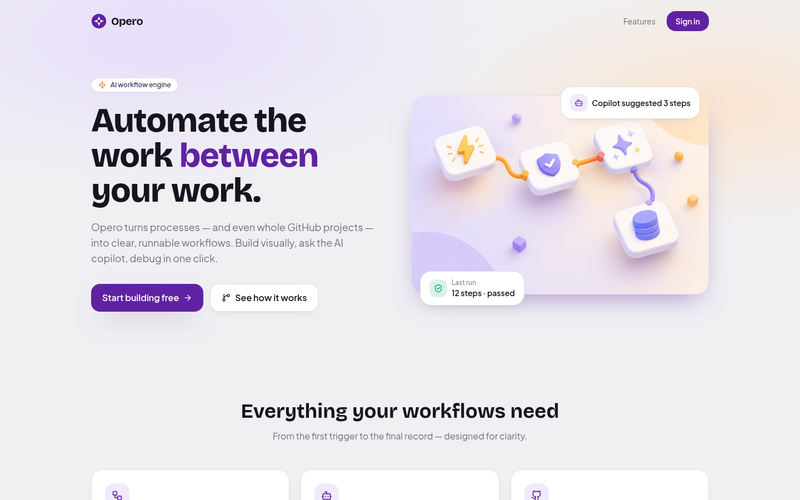
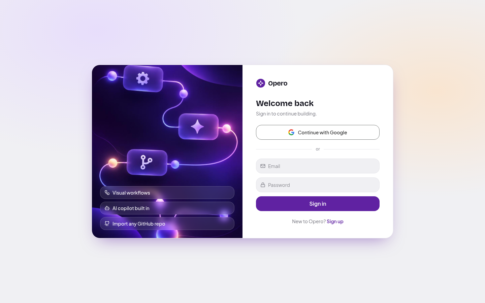

<div align="center">

# Opero

### Visual AI workflow automation platform

**Created by Noubia Hance**

Build, debug and automate workflows on a visual canvas, with an AI copilot and GitHub project import.

</div>

---

## Screenshots

| Landing page | Sign in |
| --- | --- |
|  |  |

> Screenshots of the signed-in workspace and workflow editor are not included yet.

## Features

- **Visual workflow builder**: triggers, validations, actions, identify, AI process, AI tasks, stop and outcome nodes, with labeled branches ("if valid", "else"), undo/redo, zoom, auto layout and autosave.
- **Step inspector**: edit titles, types, descriptions, next-step conditions and required validation fields.
- **Debug mode**: step-by-step simulated runs with live highlighting, saved to run history.
- **AI copilot**: chat that knows the current workflow, plus "Get AI Insight" and generating a workflow from a description.
- **GitHub import**: paste a public repo link; Opero reads its files and README and creates a project with workflows for its pages and features.
- **Workspace**: projects, credentials, a data table of runs, analytics charts, settings (with dark mode) and a help centre.
- **Sign in**: email/password and Google sign-in.
- **Responsive**: works on phones, tablets and desktops.

## Tech stack

TanStack Start (React 19) · Tailwind CSS v4 · React Flow · Framer Motion · Lovable Cloud (database + auth) · Lovable AI Gateway

## Getting started

```bash
bun install
bun run dev
```

## Author

Designed and created by **Noubia Hance**.
